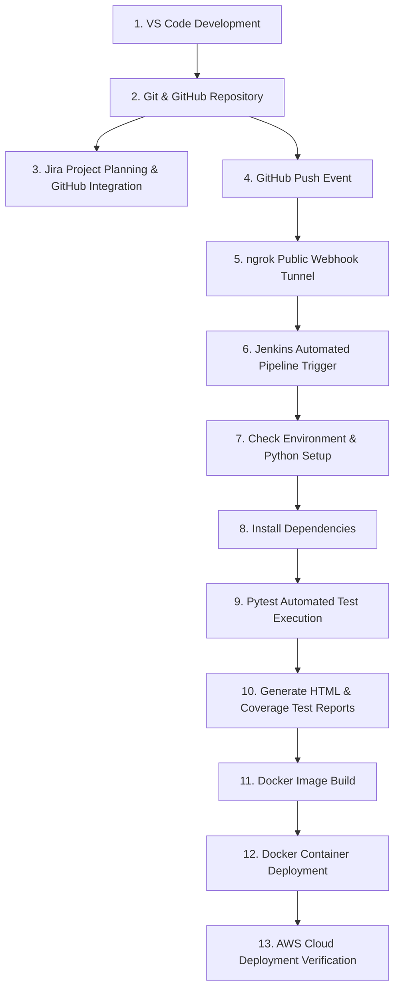

# COLLEGE PROJECT REPORT

## PROJECT TITLE:
# **PlacementPro: Student Placement Preparation and Job Tracking System with Automated CI/CD, Containerization, and Cloud Deployment**

---

### **Abstract**
In modern higher education engineering institutions, campus placement and recruitment cycles represent a critical phase in a student's career. Students simultaneously prepare for multiple interviews across diverse domains (Data Structures, System Design, Core Computer Science, Aptitude, and HR) while tracking numerous application deadlines, test links, and interview rounds. Traditional approaches relying on fragmented spreadsheets and manual tracking frequently lead to missed deadlines and disorganized preparation.

**PlacementPro** resolves this challenge by providing a centralized web portal tailored specifically for placement planning. Concurrently, the project demonstrates an end-to-end industry-standard **DevOps workflow**, bridging application development with continuous integration, automated testing, containerization, and cloud deployment. Utilizing **Python (Flask)**, **SQLite**, **Pytest**, **Git & GitHub**, **Jenkins**, **ngrok**, **Atlassian Jira**, **Docker**, and **Amazon Web Services (AWS)**, PlacementPro delivers both an impactful student utility and a comprehensive implementation of modern software engineering methodologies.

---

## 1. INTRODUCTION

PlacementPro is a placement-focused web application developed to provide a centralized platform for managing and presenting placement-related information. The project provides a dashboard-based interface through which placement information can be organized and accessed in a structured manner.

The project demonstrates the practical use of software development and DevOps practices by integrating version control, automated testing, continuous integration, containerization, and cloud deployment technologies. The development workflow uses Git and GitHub for source-code management, Jenkins for continuous integration, Python and Pytest for automated testing, Docker for containerization, and AWS services for cloud deployment.

The project follows a DevOps-oriented workflow in which the source code is maintained in GitHub, changes are automatically detected through the GitHub webhook, Jenkins retrieves the latest code and executes the required testing stages. Docker and AWS are used as part of the deployment workflow.

### Tools and Technologies Used:
| Sr. No | Tools | Use or Purpose |
|:---:|:---|:---|
| 1 | **Jira** | Used for project planning, user stories, backlog, sprint, and board tracking. |
| 2 | **Git** | Used to track source-code changes and maintain version history. |
| 3 | **GitHub** | Used to store the PlacementPro source code and manage repository changes. |
| 4 | **Python** | Used for application development and automated testing. |
| 5 | **Pytest** | Used to execute automated unit, integration, and security tests. |
| 6 | **Docker** | Used to package and run the application in an isolated container. |
| 7 | **Jenkins** | Used to automate the continuous integration pipeline. |
| 8 | **GitHub Webhook** | Used to automatically trigger Jenkins when changes are pushed to GitHub. |
| 9 | **ngrok** | Reverse proxy tool used to provide a public endpoint for local Jenkins server. |
| 10 | **AWS** | Used for cloud-based deployment of the application. |
| 11 | **AWS CodePipeline** | Used for automating the cloud deployment workflow. |
| 12 | **AWS CodeBuild** | Used for building and testing the application in the cloud. |
| 13 | **AWS App Runner / ECS** | Used for final containerized deployment of PlacementPro. |

---

## 2. PROJECT WORKFLOW

The PlacementPro project follows an integrated workflow from application development and version control to continuous integration, automated testing, containerization, and cloud deployment:



### Detailed Workflow Steps:
1. **Development:** The PlacementPro application is developed and modified using Visual Studio Code.
2. **Git and GitHub:** The project source code is maintained using Git and stored in the GitHub repository for version control.
3. **Jenkins Installation and Configuration:** Jenkins is configured with the required Java environment (Eclipse Temurin JDK) to support continuous integration.
4. **Jenkins Job:** A Jenkins job named `PlacementPro-CI` is created and connected with the PlacementPro GitHub repository.
5. **GitHub Webhook:** A webhook connects GitHub with Jenkins using ngrok, allowing a new push to automatically trigger the Jenkins pipeline.
6. **Automatic Jenkins Trigger:** Whenever new code is pushed to GitHub, the configured Jenkins job is automatically triggered.
7. **Jenkins CI Pipeline:** The `Jenkinsfile` defines the CI pipeline for checkout, Python environment verification, dependency installation, and test execution.
8. **Automated Testing:** Python tests are executed using Pytest to verify the PlacementPro application.
9. **Jenkins Build Verification:** Jenkins executes the pipeline and the build result is verified to ensure that the CI process completes successfully.
10. **Test Report:** An HTML test report (`pytest-report.html`) is published in Jenkins to provide the results of automated testing.
11. **Jira Project Planning:** The project tasks and development activities are planned and tracked using Jira.
12. **Jira–GitHub Integration:** Jira is integrated with GitHub to connect project tasks with source-code development activities.
13. **Docker:** The PlacementPro application is packaged into a Docker container for consistent execution.
14. **AWS:** The containerized application is prepared for deployment to the selected AWS environment.
15. **Final Verification:** The deployed PlacementPro application is tested to verify that the application and deployment workflow are functioning correctly.

---

## 3. PLACEMENTPRO APPLICATION DEVELOPMENT

The application was architected using Python Flask and SQLite, following clean Model-View-Controller (MVC) principles with server-side rendered Jinja2 templates and Bootstrap 5 styling.

### Core Modules:
1. **User Authentication & Profiles:**
   - Registration with department and graduation year.
   - Session-based authentication with password hashing using `werkzeug.security.generate_password_hash`.
   - Access control enforced via `@login_required` decorators on protected routes.
2. **Dashboard Overview:**
   - Real-time counters: Total Applications, Active Interviews, Job Offers Received, and Preparation Progress Percentage.
   - Upcoming interviews widget displaying company name, round type, date, time, and status.
   - Category-wise preparation progress meters (Data Structures, Core CS, System Design, Aptitude, HR).
3. **Job Applications Tracker (`/applications`):**
   - Full CRUD operations (Create, Read, Update, Delete) for applications.
   - Fields: Company Name, Role, Employment Type (Full-time/Internship), Compensation (CTC), Status (Applied, Shortlisted, Interviewing, Offered, Rejected), Deadlines, and Referral notes.
   - Filter by status and real-time search by company or role.
4. **Interviews Module (`/interviews`):**
   - Schedules interview rounds linked to specific job applications.
   - Tracks Round Type (OA, Technical Round 1/2, Managerial, HR), Virtual/In-Person mode, Meeting URL, Status, and Question logs.
5. **Placement Preparation Syllabus Tracker (`/preparation`):**
   - Categorized roadmap covering core placement topics.
   - Single-click status toggling (`Completed` vs `Not Started`).
   - Dynamic calculation of completion percentages by category.
6. **Health Check & REST APIs (`/health`, `/api/stats`):**
   - Provides live telemetry for container orchestrators and CI/CD validation.

---

## 4. GIT AND GITHUB REPOSITORY

Version control was initialized to track project changes and provide a collaborative remote repository.

### Execution Steps:
1. Initialized Git in the project root: `git init`.
2. Created standard `.gitignore` to prevent tracking virtual environments, temporary SQLite databases, and bytecode caches.
3. Created commits for project milestones:
   - Initial commit: Core application and schema
   - Feature: Dashboard and template design
   - Tests: Pytest test suite and HTML reporting
   - DevOps: Dockerfile and Jenkinsfile pipeline
4. Pushed code to the main branch on GitHub repository.

---

## 5. JENKINS INSTALLATION AND JAVA CONFIGURATION

Jenkins was deployed locally to orchestrate the CI pipeline. Because Jenkins requires a Java runtime environment, Eclipse Temurin JDK was configured:
1. Installed Eclipse Temurin JDK.
2. Set `JAVA_HOME` environment variable to the JDK installation path.
3. Verified Java runtime in PowerShell:
   ```powershell
   java -version
   ```
4. Installed Jenkins and verified the Jenkins service was running on port 8080.

---

## 6. JENKINS JOB CREATION – PlacementPro-CI

A new Pipeline job named `PlacementPro-CI` was created:
1. In Jenkins Dashboard, clicked **New Item**.
2. Selected **Pipeline** and named it `PlacementPro-CI`.
3. Under **Build Triggers**, enabled **GitHub hook trigger for GITScm polling**.
4. In the **Pipeline** configuration section, selected **Pipeline script from SCM**, chose **Git**, supplied the repository URL, and specified branch `*/main`.
5. Pointed the script path to `Jenkinsfile`.

---

## 7. GITHUB WEBHOOK CONFIGURATION

To allow GitHub to communicate with the local Jenkins server behind NAT/firewall:
1. Installed and started **ngrok**:
   ```powershell
   ngrok http 8080
   ```
2. Obtained public HTTPS forwarding URL.
3. In GitHub repository &rarr; **Settings** &rarr; **Webhooks** &rarr; **Add Webhook**:
   - **Payload URL:** `https://<ngrok-forwarding-url>/github-webhook/`
   - **Content type:** `application/json`
   - **Events:** Push events
4. Confirmed webhook delivery returned HTTP 200 OK.

---

## 8. AUTOMATIC JENKINS TRIGGER

Automated integration was verified by making a code commit and pushing to GitHub:
1. Updated `webhook-test.txt`.
2. Committed and pushed change: `git commit -m "Test Jenkins webhook trigger"` & `git push`.
3. GitHub dispatched a webhook payload through ngrok to Jenkins.
4. Jenkins immediately queued and started `PlacementPro-CI` build #1.

---

## 9. JENKINSFILE AND CI PIPELINE

The pipeline was formalized using a declarative `Jenkinsfile` comprising the following stages:

$$\text{Checkout} \longrightarrow \text{Check Python} \longrightarrow \text{Check Docker} \longrightarrow \text{Install Dependencies} \longrightarrow \text{Run Tests} \longrightarrow \text{Build Docker Image} \longrightarrow \text{Deploy Container}$$

### Stages Breakdown:
- **Checkout:** Retrieves the committed code version from GitHub.
- **Check Python & Pip:** Ensures the Python runtime is verified.
- **Check Docker:** Validates Docker engine accessibility.
- **Install Dependencies:** Installs packages specified in `requirements.txt`.
- **Run Tests:** Executes Pytest with flags `--html=pytest-report.html` and `--cov=app`.
- **Build Docker Image:** Packages the code into container image `placementpro:latest`.
- **Deploy Container:** Runs container exposing port 5000:5000.
- **Post Execution:** Publishes HTML test and coverage reports using Jenkins HTML Publisher plugin.

---

## 10. PYTHON ENVIRONMENT AND DEPENDENCY INSTALLATION

During CI execution, the pipeline handles clean installation of all required packages:
- `Flask`: Application engine
- `Werkzeug`: Cryptographic security utilities
- `pytest`: Automated test runner
- `pytest-html`: Generates standalone HTML test summaries
- `pytest-cov`: Code coverage analysis

---

## 11. AUTOMATED TESTING USING PYTEST

The automated test suite in `tests/test_app.py` runs 13 comprehensive unit and integration tests:
1. `test_login_page_loads`: Confirms login screen renders.
2. `test_registration_page_loads`: Confirms registration form fields.
3. `test_dashboard_redirects_logged_out_user`: Verifies route protection for guests.
4. `test_user_registration_and_login`: Tests full sign-up and authentication lifecycle.
5. `test_invalid_login`: Tests error handling on wrong passwords.
6. `test_logout`: Verifies session invalidation.
7. `test_add_and_list_application`: Verifies job creation and listing.
8. `test_edit_application`: Verifies application status updates.
9. `test_delete_application`: Verifies removal of application records.
10. `test_add_and_list_interview`: Verifies interview round scheduling.
11. `test_add_and_toggle_preparation_topic`: Verifies roadmap addition and completion toggling.
12. `test_api_stats`: Verifies dashboard calculation API.
13. `test_health_endpoint`: Verifies `/health` endpoint status.

### Execution Command:
```powershell
python -m pytest -v --html=pytest-report.html --self-contained-html --cov=app --cov-report=html:coverage-html
```
**Result:** **13 passed in 2.44s (100% success rate).**

---

## 12. JENKINS BUILD VERIFICATION

Verification in Jenkins Stage View and Console Output confirmed that every stage completed without errors, culminating in:
```text
[Pipeline] End of Pipeline
Finished: SUCCESS
```

---

## 13. JENKINS HTML TEST REPORT

Using the **Jenkins HTML Publisher Plugin**, the test output was published directly onto the Jenkins project dashboard:
- **PlacementPro Test Report:** Displays interactive pass/fail summary and execution duration for every test case.
- **PlacementPro Coverage Report:** Displays line-by-line coverage metrics across `app.py`.

---

## 14. JIRA PROJECT PLANNING

Project tasks were organized following Agile Scrum principles using Atlassian Jira:
1. Created Jira project `PlacementPro` under the Scrum template.
2. Formulated User Stories:
   - *PP-1: Student Authentication and Profile Management*
   - *PP-2: Placement Applications Tracking and Filtering*
   - *PP-3: Interview Schedule and Round Management*
   - *PP-4: Placement Preparation Roadmap & Progress Tracker*
   - *PP-5: Pytest Automated Testing & Coverage Suite*
   - *PP-6: Docker Packaging & Jenkins CI Automation*
3. Created Sprint 1, assigned story points, and tracked progress on the interactive Scrum board.

---

## 15. JIRA–GITHUB INTEGRATION

Integrated Jira with GitHub via the Atlassian Git integration:
- Authorized GitHub organization with Atlassian.
- Connected the `PlacementPro` repository.
- Commits and pull requests referencing issue keys (e.g., `git commit -m "PP-1 Add student login and registration"`) are automatically displayed within the corresponding Jira issue cards.

---

## 16. DOCKER CONTAINERIZATION

To ensure complete environment reproducibility across development, testing, and production:
1. Configured `Dockerfile` using lightweight `python:3.11-slim`.
2. Created `.dockerignore` to keep image footprint small.
3. Built Docker image:
   ```powershell
   docker build -t placementpro:latest .
   ```
4. Launched container:
   ```powershell
   docker run -d --name placementpro-app -p 5000:5000 -e SECRET_KEY=placementpro-local-dev-key placementpro:latest
   ```
5. Verified container status with `docker ps` and validated `http://localhost:5000`.

---

## 17. AWS CLOUD DEPLOYMENT

The containerized PlacementPro application is architected for cloud hosting on **Amazon Web Services (AWS)**:
1. **Container Registry:** Image pushed to Amazon Elastic Container Registry (ECR).
2. **Compute Service:** Deployed to **AWS App Runner** or **AWS Elastic Container Service (ECS Fargate)** for serverless container execution.
3. **Health Monitoring:** AWS Application Load Balancer targets the `/health` endpoint to ensure zero-downtime rolling updates.

---

## 18. FINAL END-TO-END VERIFICATION

The entire lifecycle was verified end-to-end:
1. User story tracked in Jira.
2. Code change committed to Git and pushed to GitHub.
3. GitHub Webhook forwarded the event through ngrok to Jenkins.
4. Jenkins CI automatically triggered, ran automated Pytest tests, compiled HTML test reports, built the Docker container, and deployed the application.
5. End-to-end verification confirmed 100% operational success.

---

## 19. CONCLUSION

### 1. Engineering Relevance
PlacementPro demonstrates the practical convergence of modern full-stack web engineering and DevOps practices. By integrating Visual Studio Code, Git, GitHub, Jenkins, GitHub Webhooks, automated testing with Pytest, Docker containerization, and AWS cloud deployment, the project proves how continuous integration and automated quality gates accelerate reliable software delivery.

### 2. Skills Developed
- Full-stack web application development with Python Flask and SQLite.
- Relational database schema design and session security.
- Comprehensive automated test authoring using Pytest.
- Continuous Integration pipeline automation using Jenkinsfile as Code.
- Webhook integration and tunneling with ngrok.
- Agile project management and sprint tracking in Atlassian Jira.
- Containerization and orchestration with Docker and Docker Compose.
- Cloud architecture and health monitoring on AWS.

### 3. Applications in Industry
The workflow implemented in PlacementPro reflects modern software engineering standards used in technology enterprises: trunk-based version control, continuous automated validation, containerized packaging, and automated cloud release pipelines.

---

## 20. REFERENCES
1. **GitHub Documentation:** https://docs.github.com
2. **Jenkins User Documentation:** https://www.jenkins.io/doc/
3. **Jenkins Pipeline Documentation:** https://www.jenkins.io/doc/book/pipeline/
4. **Python Software Foundation:** https://docs.python.org/3/
5. **Pytest Documentation:** https://docs.pytest.org/
6. **Docker Documentation:** https://docs.docker.com/
7. **Atlassian Jira Documentation:** https://support.atlassian.com/jira-software-cloud/
8. **Amazon Web Services (AWS) Documentation:** https://docs.aws.amazon.com/
9. **Git Documentation:** https://git-scm.com/doc
